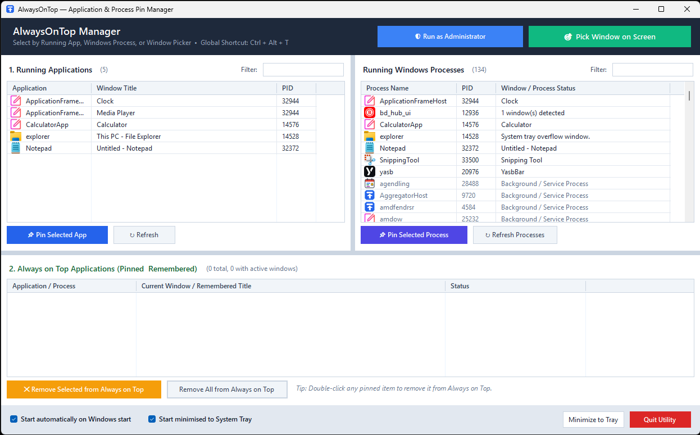
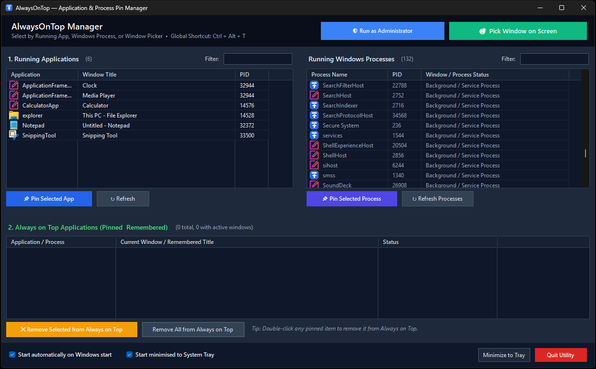

# 📌 AlwaysOnTop

**A lightweight Windows System Tray utility for keeping selected application windows always on top.**


[](https://github.com/LibbyLamarr/AlwaysOnTop/releases/latest)

**AlwaysOnTop** (`AlwaysOnTop.exe`) lets you pin individual windows or applications above other windows without keeping its main interface open. It runs quietly in the Windows System Tray and provides a global keyboard shortcut, an interactive window picker and a manager for saved pins.

Unlike a simple one-time topmost toggle, AlwaysOnTop remembers pinned applications and can reapply their topmost status when their windows are reopened or recreated. It also includes handling for elevated windows, related processes and the relative stacking order of multiple pinned windows.

No installer or third-party NuGet packages are required. The utility uses the Windows .NET Framework and native Windows APIs.

## ⬇️ Download

**[Download the latest version of AlwaysOnTop](https://github.com/LibbyLamarr/AlwaysOnTop/releases/latest)**

Download `AlwaysOnTop.exe` from the release assets and run it on Windows 10 or Windows 11.

- No installation required.
- No third-party dependencies.
- Requires .NET Framework 4.x.
- Administrator privileges are only needed when managing certain elevated applications.

> **Note:** Windows SmartScreen may display a warning because the executable is not digitally signed. The complete source code is available in this repository for inspection.

## 📸 Screenshots

### Light theme



### Dark theme



A **System** theme is also available and follows the Windows light/dark appearance setting.

## ✨ Features

- **Three ways to pin:** choose a visible application, select a running process or pick a window directly on screen.
- **Persistent pins:** remember selected applications and automatically re-pin them when they reopen.
- **Global hotkey:** press `Ctrl + Alt + T` to toggle the currently active window's topmost state.
- **Multi-process support:** recognise related processes within application suites and manage their windows together.
- **Elevated-window support:** detect applications running as Administrator and offer a way to restart the utility with matching privileges when needed.
- **Z-order awareness:** apply topmost status in back-to-front order to reduce unwanted reshuffling of pinned windows.
- **System Tray operation:** keep the utility running after closing its manager window.
- **Startup options:** launch at Windows sign-in and optionally start minimised.
- **Themes:** System, Light and Dark.
- **Portable executable:** approximately 65 KB, with no third-party package dependencies.

## 🚀 Getting started

### Requirements

- Windows 10 or Windows 11
- .NET Framework 4.x
- Administrator privileges only when required to manage elevated applications

### Run the utility

1. Download `AlwaysOnTop.exe` from this repository's **Releases** page, if a release is available, or [build it from source](#-building-from-source).
2. Save the executable in a folder of your choice.
3. Double-click `AlwaysOnTop.exe`.
4. Select an application to pin, use the screen picker or focus a window and press `Ctrl + Alt + T`.

There is no installer. Closing the manager window minimises it to the System Tray; use **Quit Utility** to stop it completely.

> **Tip:** AlwaysOnTop must remain running for automatic re-pinning and ongoing management of saved pins.

## 📌 Pinning windows

### 1. Running Applications

The **Running Applications** panel (top left) lists currently visible standard application windows and provides a live search filter.

Select one or more entries and click **📌 Pin Selected App**, or double-click a row to pin it immediately.

### 2. Running Windows Processes

The **Running Windows Processes** panel (top right) lists active processes, including their names, process IDs (PIDs) and detected window status. A live filter helps locate a process quickly.

This is useful when an application uses non-standard windows or does not appear in the conventional visible-window list.

### 3. Interactive Window Picker

Click **🎯 Pick Window on Screen** to enter screen-picking mode:

1. The pointer changes to a crosshair (`+`).
2. Hover over a window to see a floating preview of its application, window title and PID.
3. Left-click the window to pin it.

Press `Esc`, right-click or click an empty desktop/taskbar area to cancel.

## 🔄 Managing persistent pins

The **Always on Top Applications** panel lists saved pinned applications. Their details are stored in `AlwaysOnTop.settings.json`.

- **Automatic re-pinning:** when a saved application closes and later reopens, the utility detects its new window and restores the topmost setting.
- **Remove one or more pins:** select entries and click **✕ Remove Selected from Always on Top**, or double-click an entry.
- **Remove all pins:** click **Remove All from Always on Top**.
- **Clean exit:** **Quit Utility** removes the topmost flag from currently managed windows before exiting normally.

## 🛡️ Advanced window handling

### Elevated applications

Windows User Interface Privilege Isolation (UIPI) restricts some interactions between processes running at different privilege levels. AlwaysOnTop detects elevated target processes and provides a **🛡️ Run as Administrator** option when higher privileges are needed.

> Run the utility as Administrator only when necessary. Some protected windows remain subject to Windows security restrictions.

### Related processes

Some applications create multiple processes for separate parts of their interface. AlwaysOnTop can match related processes by a shared suite prefix, allowing their associated windows to be managed together.

### Stubborn or custom-framed windows

The utility uses Win32 `SetWindowPos` with `HWND_TOPMOST` and includes an `AttachThreadInput` fallback for windows that do not respond reliably to ordinary topmost operations.

### Relative Z-order

When several windows are pinned, repeatedly applying topmost status can cause unwanted changes in which pinned window appears in front. AlwaysOnTop applies updates in back-to-front Z-order to help preserve the existing relative stacking order.

These techniques improve compatibility but cannot guarantee topmost behaviour for every Windows application.

## 🎨 Themes

Right-click the System Tray icon and choose **Theme**:

| Theme | Behaviour |
| --- | --- |
| **System** | Follows the Windows light/dark setting, including changes while running |
| **Light** | Uses the light interface |
| **Dark** | Uses a dark slate interface, including title bar, column headers, grid lines and scrollbars |

## ⚙️ System Tray and startup

- **Minimise to Tray:** clicking the main window's `X` or **Minimize to Tray** keeps the utility running in the System Tray.
- **Open manager:** left-click or double-click the tray icon.
- **Start with Windows:** optionally register the utility at sign-in under `HKCU\Software\Microsoft\Windows\CurrentVersion\Run`.
- **Start minimised:** optionally launch directly into the System Tray.
- **Quit completely:** select **Quit Utility** in the main window or tray menu.

## ⌨️ Shortcuts and controls

| Action | Control |
| --- | --- |
| Toggle topmost state of the active window | `Ctrl + Alt + T` |
| Pin an application or process | Select and click **Pin**, or double-click |
| Remove a saved pin | Select and click **Remove**, or double-click |
| Pick a window on screen | **🎯 Pick Window on Screen**, then left-click the target |
| Cancel screen picker | `Esc`, right-click or click empty desktop/taskbar |
| Change theme | Tray icon → **Theme** |
| Open manager | Left-click or double-click tray icon |
| Exit completely | **Quit Utility** |

## 🛠️ Building from source

AlwaysOnTop is written in C# with Windows Forms and Win32 P/Invoke. The included build script uses the .NET Framework C# compiler, so Visual Studio and third-party NuGet packages are not required.

1. Clone the repository (replace `<your-username>` with the repository owner's GitHub username):

   ```cmd
   git clone https://github.com/<your-username>/AlwaysOnTop.git
   cd AlwaysOnTop
   ```

2. Run the build script:

   ```cmd
   build.bat
   ```

3. Run the resulting `AlwaysOnTop.exe` (approximately 65 KB).

The build script uses:

```text
%WINDIR%\Microsoft.NET\Framework64\v4.0.30319\csc.exe
```

## 📁 Project files

```text
AlwaysOnTop/
├── screenshots/
│   ├── AlwaysOnTop-Light.png
│   └── AlwaysOnTop-Dark.png
├── AlwaysOnTop.cs
├── app.ico
├── build.bat
├── README.md
└── LICENSE
```

| File | Purpose |
| --- | --- |
| `AlwaysOnTop.cs` | C# source, WinForms interface, native Windows integration and topmost engine |
| `app.ico` | Multi-resolution application and tray icon |
| `build.bat` | One-click compilation script |
| `screenshots/` | Light and Dark theme screenshots |
| `README.md` | Project documentation |
| `LICENSE` | MIT License |

`AlwaysOnTop.exe` is the compiled output (and may be provided as a release download). `AlwaysOnTop.settings.json` is generated at runtime and stores saved pins and preferences; it should not be committed with personal settings.

## ⚠️ Limitations

- Windows only; macOS and Linux are not supported.
- Managing some elevated applications may require running AlwaysOnTop as Administrator.
- Protected windows and exclusive-fullscreen applications may not be manageable.
- Some applications override topmost settings or use window behaviour that cannot be controlled reliably.
- Automatic re-pinning requires AlwaysOnTop to remain running.

## 💬 About this project

AlwaysOnTop is a personal project, shared in case others find it useful. It has been developed with AI assistance, and I am continuing to test, refine and improve its features.

Feedback, bug reports and contributions are welcome through GitHub Issues and pull requests.

## 📄 License

Released under the [MIT License](LICENSE).
